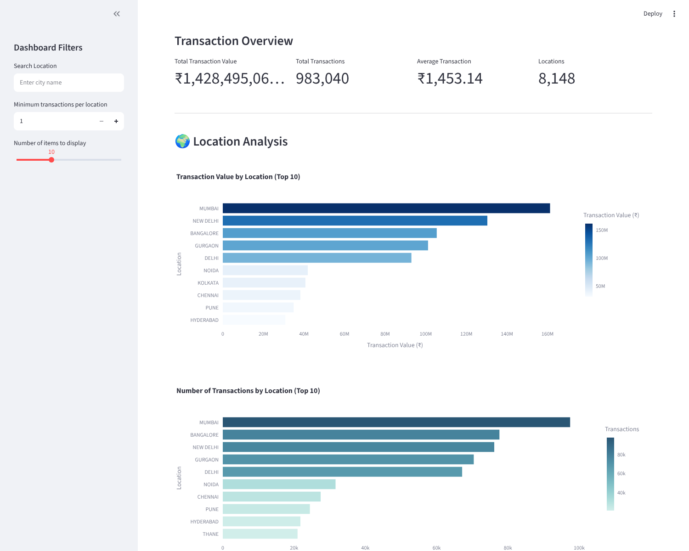
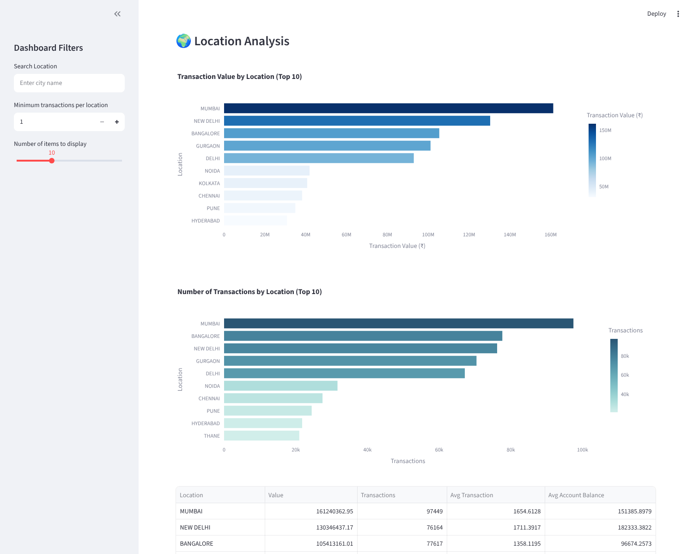
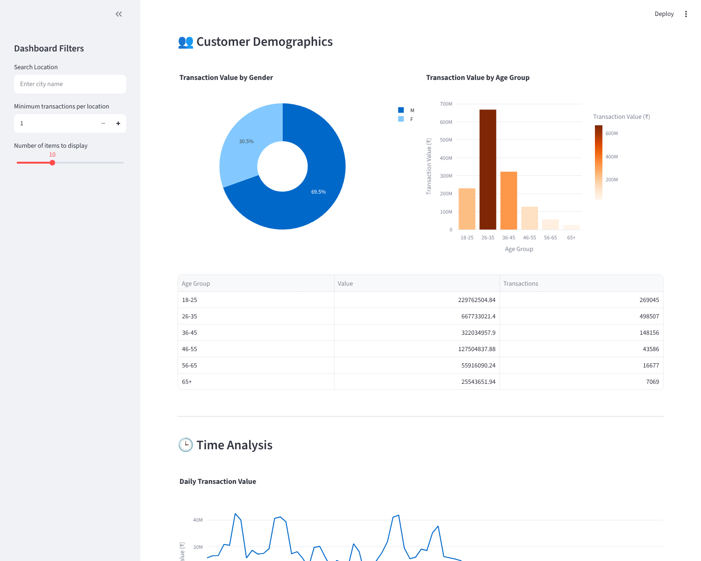
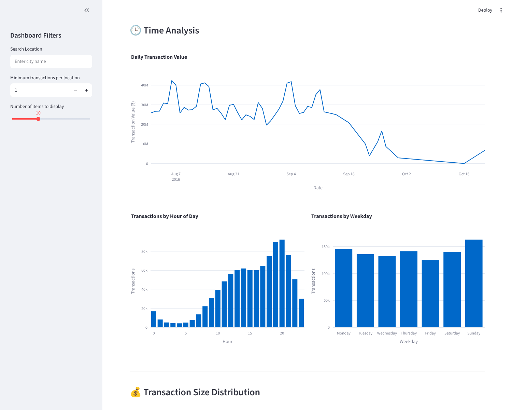
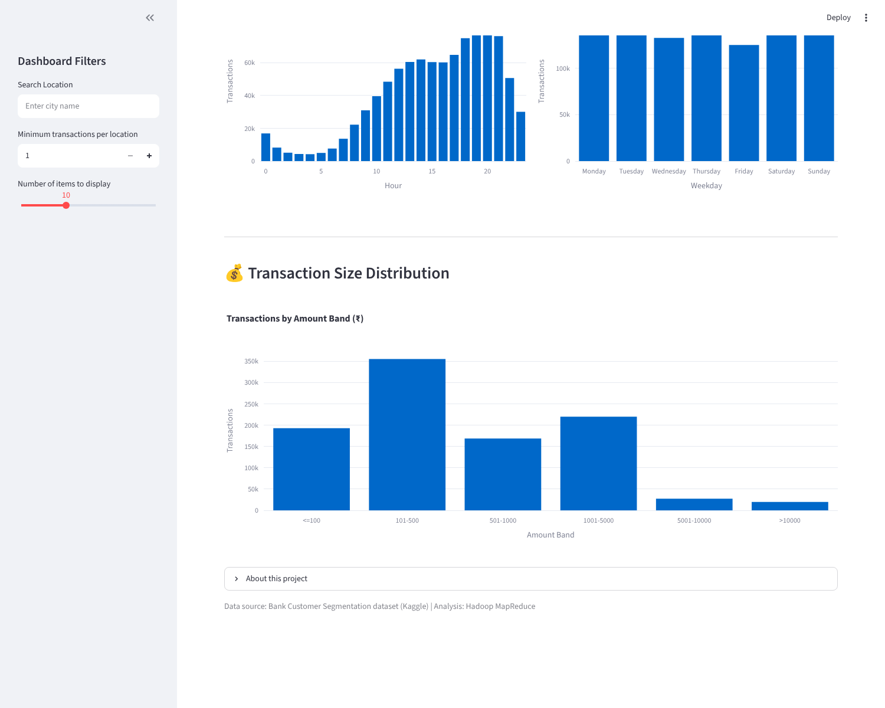

# Bank Customer Segmentation Analysis

## 1. Project Overview
This project analyzes retail banking transaction data using Apache Hadoop, HDFS, Hadoop Streaming, Python MapReduce, and an interactive Streamlit dashboard.

## 2. Dataset
Dataset: Bank Customer Segmentation (bank transactions)
Source: Kaggle (public dataset)
Link: https://www.kaggle.com/datasets/shivamb/bank-customer-segmentation

The original dataset contains 1,048,567 records and 9 columns (about 65 MB). Each record is one transaction by a customer of an Indian bank, with customer date of birth, gender, location, account balance, transaction date/time and transaction amount in Indian Rupees (INR). After cleaning, 983,040 records and 12 columns remain.

See input/README.md for dataset details.

## 3. Data Cleaning
The cleaning process excludes records with invalid or missing gender, missing location, missing account balance, non-positive transaction amounts, and invalid birth dates (the placeholder date 1/1/1800, or an implied age outside 18-100).

| Cleaning step | Rows removed |
|---|---|
| Invalid or missing gender | 1,101 |
| Missing location | 151 |
| Missing account balance | 2,369 |
| Non-positive amount | 830 |
| Invalid / placeholder birth date | 61,076 |
| **Total removed** | **65,527** |

Derived columns: Age, AgeGroup, TransactionHour, Weekday and AmountBand. Dates are converted from d/m/yy to ISO format (YYYY-MM-DD).

## 4. Hadoop MapReduce Workflow
1. Standardize the CSV and column names (`convert_to_csv.py`).
2. Inspect the standardized dataset (`inspect_data.py`).
3. Clean the transaction data (`clean_data.py`).
4. Upload the processed data to HDFS (`run_hadoop.sh`).
5. Run the Python mapper and reducer using Hadoop Streaming.
6. Analyze the aggregated results.
7. Display the findings using charts and an interactive dashboard.

The mapper emits one key-value pair per metric for every transaction (total value, total count, and value/count by gender, location, age group, month, day, weekday, hour and amount band, plus balance sum by location). The reducer sums the values for each key. The same reducer is also used as the combiner.

### How the results were produced
The results in `results/mapreduce_output.txt` were produced with `run_local_mapreduce.sh`. It runs the exact same `mapper.py` and `reducer.py` through the Unix pipeline that mirrors Hadoop Streaming (map, then shuffle and sort, then reduce): `cat data | mapper.py | sort | reducer.py`. The output was verified against an independent pandas calculation and all 24,560 values matched. The full pipeline (convert, clean, MapReduce) reproduces `results/mapreduce_output.txt` and `results/cleaning_summary.json` exactly; the local MapReduce step takes roughly 2 minutes.

`run_hadoop.sh` contains the equivalent HDFS upload and Hadoop Streaming job for a Hadoop cluster.

## 5. Key Results
- Cleaned transaction records: 983,040
- Total transaction value: INR 1,428,495,064.20
- Average transaction: INR 1,453.14
- Unique customers: 837,433
- Unique locations: 8,148
- MapReduce output records: 24,560

Highlights:
- Top locations by value: Mumbai (INR 161.2M), New Delhi (130.3M), Bangalore (105.4M), Gurgaon (101.1M), Delhi (92.9M).
- Customers aged 26-35 account for the largest share of value (INR 667.7M).
- Male customers account for about 69.5% of transaction value and 72.3% of transactions.
- Activity peaks in the evening, at 20:00, 19:00 and 21:00.
- Sunday has the most transactions; Friday has the fewest.

Note: the data covers only 55 days between August and October 2016, and October contains just a few days, so the monthly comparison is not like for like. Values are transaction amounts, not bank revenue or profit.

## 6. Visualizations
- results/top_10_locations.png
- results/top_10_locations_by_count.png
- results/age_group_value.png
- results/transactions_by_hour.png
- results/daily_transaction_value.png

## 7. Interactive Dashboard
The Streamlit dashboard displays transaction KPIs, location analysis with search, minimum-transaction filter and top-N slider, gender and age demographics, daily/hourly/weekday trends and the transaction size distribution.

### Screenshots

See `screenshots/README.md` for the full list.

## 8. Installation
Requires Python 3.9+. Install the required Python packages:

pip install -r requirements.txt

## 9. Run the Pipeline and Dashboard
The original dataset is already placed at `input/bank_transactions_original.csv`, so everything runs offline. All scripts use paths relative to the project folder and can be run from any directory.

One command (macOS/Linux/WSL, runs every step except the dashboard):

./run_all.sh

Or step by step:

python3 convert_to_csv.py
python3 inspect_data.py
python3 clean_data.py
./run_local_mapreduce.sh      # or ./run_hadoop.sh on a Hadoop cluster
python3 visualize_results.py
streamlit run dashboard.py

The dashboard only needs `results/mapreduce_output.txt` and `results/cleaning_summary.json` (both included), so `streamlit run dashboard.py` works immediately without re-running the pipeline.

## 10. Main Project Files
- inspect_data.py: Inspects the dataset.
- convert_to_csv.py: Standardizes the CSV and column names.
- clean_data.py: Cleans transaction data and creates derived columns.
- mapper.py: Generates MapReduce key-value pairs.
- reducer.py: Aggregates values.
- run_hadoop.sh: Runs the job on a Hadoop cluster using Hadoop Streaming.
- run_local_mapreduce.sh: Runs the same job locally without Hadoop.
- run_all.sh: Runs the full pipeline offline in one command.
- visualize_results.py: Creates charts.
- dashboard.py: Runs the interactive dashboard.
- results/mapreduce_output.txt: Contains aggregated results.
- results/cleaning_summary.json: Cleaning statistics.
- requirements.txt: Lists Python dependencies.
- screenshots/: Dashboard screenshots.
- input/README.md: Dataset information.
